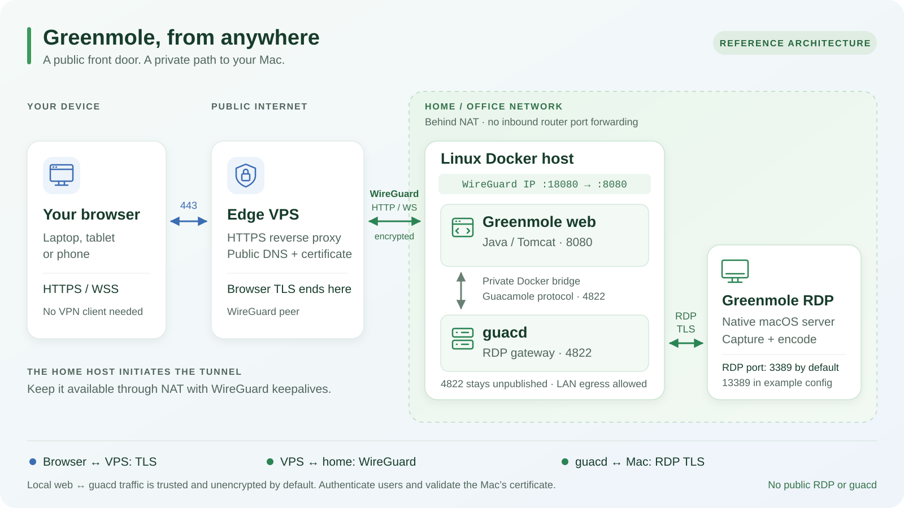

# Greenmole RDP


[](https://www.gnu.org/licenses/gpl-3.0)
[](https://www.rust-lang.org/)
[](https://www.apple.com/macos/)
[](#)

**macOS Remote Desktop Server**

A native RDP server for macOS. Connect to your Mac from Windows, Linux, iOS or
Android using a compatible RDP client, including Windows Remote Desktop
(mstsc), Microsoft Remote Desktop, FreeRDP, or Greenmole/Guacamole.

Greenmole RDP is the macOS server companion to the Greenmole browser client. It
also supports Windows Remote Desktop Connection and other compatible RDP clients.

Greenmole RDP is an independently maintained fork of
[MacRDP](https://github.com/x6nux/macrdp), originally created by
[x6nux](https://github.com/x6nux). We gratefully acknowledge the original project
and its contributors. See [NOTICE](NOTICE) for source attribution.

---

## Features

- **Standard RDP protocol** — supports Windows Remote Desktop and Greenmole/Guacamole clients
- **Hardware-accelerated encoding** — GPU-powered H.264 via Apple VideoToolbox, low latency on Apple Silicon
- **High fidelity color** — AVC420 and AVC444 video, with negotiated image fallback
- **Localized keyboard & mouse** — seven text layouts, independent Windows/Mac shortcut preferences, numpad and scroll; see [keyboard configuration](docs/keyboard-layouts.md)
- **HiDPI / Retina support** — capture at 2x/3x resolution for sharp 4K remote display
- **Experimental virtual display** — an extended macOS desktop that follows the Guacamole viewport; see [setup and testing](docs/virtual-display.md)
- **Configurable** — resolution, frame rate, bitrate, encoder, quality presets, all via simple TOML config
- **Authenticated connections** — NLA/CredSSP authentication and managed or custom TLS certificates
- **Session diagnostics** — current phases, recent outcomes and evidence-based cleanup status
- **Graphics profiles** — saved Mobile, Desktop, Limited bandwidth and custom settings
- **Guarded private sessions** — opt-in local input protection and lock restoration; see [limits and testing](docs/private-sessions.md)

---

## Requirements

- **macOS 14+** (Sonoma or later)
- A Rust toolchain and the macOS build tools
- Screen Recording permission (System Settings > Privacy & Security)
- Accessibility permission (for keyboard/mouse injection)

---

## Quick Start

```bash
# Build
cargo build --release

# Run
cargo run --release --bin macrdp-server

# Connect from any RDP client → your-mac-ip:3389
```

---

## Suggested deployment architecture

For browser access to a home or office LAN behind NAT, pair this native macOS
server with [Greenmole](https://github.com/beraadim/Greenmole) on a Linux Docker
host and a public edge VPS. The browser needs no WireGuard client. This is a
reference pattern; adapt the suggested ports to your installation.



[Open the deployment diagram at full size](docs/images/deployment-architecture.svg).

1. **Public edge VPS:** serve HTTPS and secure WebSocket (WSS) on TCP **443**
   with a valid certificate. Browser TLS terminates here. Configure the reverse
   proxy for WebSocket upgrades and an unbuffered HTTP tunnel fallback; follow
   the [Guacamole reverse-proxy guide](https://guacamole.apache.org/doc/gug/reverse-proxy.html).
2. **WireGuard tunnel:** have the Linux host initiate and maintain the tunnel to
   the VPS, with persistent keepalives for NAT traversal as described in the
   [WireGuard quick start](https://www.wireguard.com/quickstart/). The VPS forwards
   HTTP/WS through this encrypted tunnel; allow its configured WireGuard UDP
   port on the VPS.
3. **Greenmole web container:** run the Java application in Tomcat on TCP
   **8080**, published as `WIREGUARD_IP:18080:8080` on the Linux host. Restrict
   access to the VPS peer using firewall rules that cover Docker-published
   traffic; binding to a private address alone is insufficient. See
   [Docker port publishing](https://docs.docker.com/engine/network/port-publishing/).
4. **guacd container:** connect the web application to `guacd:4822` on a private
   Docker bridge, without publishing that port. This trusted local hop is
   unencrypted by default. Preserve outbound LAN access so guacd can reach the
   Mac; an isolated Docker `internal` network alone cannot provide that route.
5. **Greenmole RDP on the Mac:** grant Screen Recording and Accessibility
   permissions, configure credentials, and use RDP TLS with NLA and certificate
   validation. The default certificate is self-signed: establish guacd's trust
   in the Mac's certificate, or supply a certificate from a trusted CA, matching
   its hostname. Match the connection's TCP port to the Mac configuration:
   default **3389**, or **13389** in `config.example.toml`. Restrict RDP ingress
   to authorized LAN sources, including the Docker host's actual egress
   address. Keep RDP and guacd off the public internet.

Keep credentials and runtime configuration outside Git. HTTPS provides the
secure context required for experimental AVC WebCodecs decoding; compatible
browser/decoder support and explicit feature opt-in are also required.

---

## Configuration

Copy `config.example.toml` to `config.toml` and edit as needed:

```toml
# Network
port = 13389

# Authentication
username = "admin"
password = "" # Set a unique password before starting; an empty password is rejected.

# Display
width = 0          # 0 = auto-detect
height = 0
frame_rate = 60
resolution = "auto" # use display pixels and follow the client viewport

# Encoding
quality = "high_quality"    # low_latency / balanced / high_quality
encoder = "hardware"        # hardware (GPU) / software (CPU)
chroma_mode = "avc420"      # avc420 (compatible) / avc444 (best quality)
bitrate_mbps = 50           # target bitrate (Mbps)

# Keyboard
keyboard_layout = "auto"    # negotiated layout; us / uk / no / se / dk / de / fr / physical
keyboard_shortcuts = "auto" # Greenmole preference, otherwise Windows-friendly

# Logging
log_level = "info"          # trace / debug / info / warn / error
```

With `width = 0`, `height = 0`, and `resolution = "auto"`, client requests can
resize the remote desktop. A fixed value such as `resolution = "1920x1080"`
disables client-driven resizing. Legacy scale values remain supported as strings
(for example, `resolution = "2"`); these values must be quoted in TOML.

Keyboard preferences are available in **Settings → Keyboard** and take effect
after restarting the service. Keep both at `auto` to preserve the existing
Norwegian Windows experience. A Greenmole browser connection normally uses a US
transport layout even with a Norwegian local keyboard; do not change it just to
match the browser's language. See [layout selection, shortcut modes and testing
limits](docs/keyboard-layouts.md).

The desktop app is **Greenmole RDP.app**. Internal crate/binary names, the
`com.macrdp.app` application identifier and existing configuration, Keychain, TLS
and monitor-identity storage retain their `macrdp` names for upgrade compatibility.
The standalone command remains `macrdp-server`; no configuration migration is
required for the rebrand.

Config search order:

1. `./config.toml`
2. `~/.config/macrdp/config.toml`
3. `~/Library/Application Support/macrdp/config.toml`

---

## Project Structure

```
crates/
├── macrdp-server/       Main server binary
├── macrdp-capture/      Screen capture
├── macrdp-display/      Physical/virtual display ownership and mode changes
├── macrdp-input/        Keyboard & mouse injection
├── macrdp-encode/       Video encoding
├── ironrdp-server-gfx/  RDP protocol (IronRDP fork)
└── ironrdp-acceptor-patched/
                         RDP connection acceptor
```

---

## Acknowledgments

The project builds on the following open-source work:

- **[MacRDP](https://github.com/x6nux/macrdp)** — The original macOS RDP server by [x6nux](https://github.com/x6nux) and its contributors, which provides the foundation for Greenmole RDP.
- **[IronRDP](https://github.com/Devolutions/IronRDP)** — Pure Rust RDP protocol implementation. Greenmole RDP's protocol stack is built on a fork of ironrdp-server with GFX/AVC444 extensions.
- **[FreeRDP](https://github.com/FreeRDP/FreeRDP)** — The reference open-source RDP implementation. Its AVC444 dual-stream encoding approach and YUV444 B-area split algorithm were essential references.
- **[RustDesk](https://github.com/rustdesk/rustdesk)** — Open-source remote desktop software written in Rust. Its architecture for cross-platform screen capture and input injection was a great source of inspiration.
- **[Apache Guacamole](https://guacamole.apache.org/)** — Source of additional keyboard layout tables, with the Apache License 2.0 and notices retained in [the layout module](crates/macrdp-core/src/handler/layouts/).

---

## License

This project is licensed under the **GNU General Public License v3.0** — see [LICENSE](LICENSE) for details. Any derivative work must also be distributed under GPLv3.

The shared Greenmole mascot artwork retains its separate Apache License 2.0
and original notices; see [artwork provenance and licenses](branding/README.md).

---

<details>
<summary><b>Keywords</b></summary>

macOS RDP server, Mac remote desktop server, RDP server for Mac, remote desktop protocol macOS, connect to Mac from Windows, connect to Mac from Linux, connect to Mac from Android, Windows Remote Desktop to Mac, mstsc Mac, Mac remote access, Mac screen sharing, remote control Mac, Apple Silicon remote desktop, Rust RDP server, VNC alternative Mac, FreeRDP Mac server, macOS remote desktop, Mac remote desktop solution, RDP for macOS

</details>
